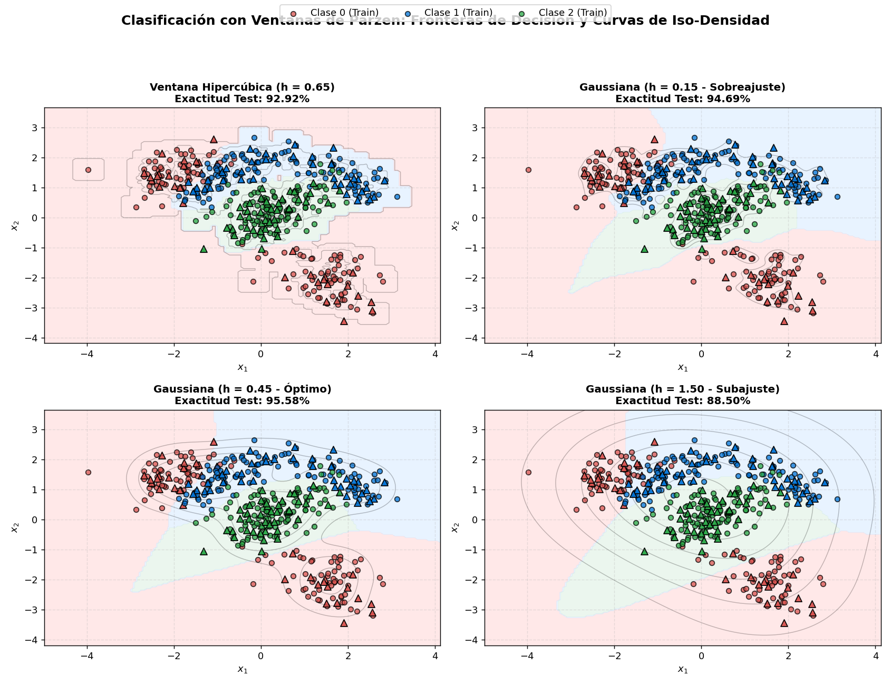

# Clasificación No Paramétrica mediante Ventanas de Parzen (Parzen-Rosenblatt)

Este proyecto implementa desde cero un **Clasificador Bayesiano No Paramétrico basado en Ventanas de Parzen** en Python (`numpy`, `pandas`, `matplotlib`, `scipy`), evaluado sobre un conjunto de datos sintético multiclase con geometrías no lineales y multimodales.

---

## 1. Fundamento Teórico

### 1.1 El Problema de la Estimación de Densidad No Paramétrica
En el reconocimiento de patrones estadístico, la **regla de decisión óptima de Bayes** asigna un vector de características $\mathbf{x} \in \mathbb{R}^d$ a la clase $\omega_k \in \{\omega_1, \dots, \omega_C\}$ que maximiza la probabilidad a posteriori:

$$\hat{\omega}(\mathbf{x}) = \arg\max_{k \in \{1, \dots, C\}} P(\omega_k \mid \mathbf{x}) = \arg\max_{k \in \{1, \dots, C\}} \Big[ p(\mathbf{x} \mid \omega_k)\, P(\omega_k) \Big]$$

Cuando las distribuciones condicionales de clase $p(\mathbf{x} \mid \omega_k)$ son **multimodales** o presentan **fronteras no lineales complejas**, asumir una forma paramétrica fija (como una única Gaussiana multivariada en LDA/QDA) introduce un alto sesgo. Los métodos **no paramétricos**, como las **Ventanas de Parzen-Rosenblatt**, estiman directamente la función de densidad de probabilidad (PDF) a partir de los datos de entrenamiento sin imponer una estructura global rígida.

---

### 1.2 Aproximación por Regiones Locales
Sea $\mathcal{D}_k = \{\mathbf{x}_1, \mathbf{x}_2, \dots, \mathbf{x}_{N_k}\}$ un conjunto de $N_k$ muestras independientes e idénticamente distribuidas (i.i.d.) pertenecientes a la clase $\omega_k$.

La probabilidad $P$ de que un vector $\mathbf{x}$ caiga dentro de una región pequeña $\mathcal{R}_n \subset \mathbb{R}^d$ centrada en $\mathbf{x}$ está dada por:

$$P = \int_{\mathcal{R}_n} p(\mathbf{x}' \mid \omega_k)\, d\mathbf{x}' \approx p(\mathbf{x} \mid \omega_k)\, V_n$$

donde $V_n$ es el volumen de la región $\mathcal{R}_n$ y se asume que $p(\mathbf{x}' \mid \omega_k)$ es prácticamente constante dentro de $\mathcal{R}_n$. Por otro lado, si $k_n$ de las $N_k$ muestras caen dentro de $\mathcal{R}_n$, la probabilidad $P$ puede estimarse empíricamente por la frecuencia relativa $P \approx k_n / N_k$. Igualando ambas expresiones se obtiene:

$$\hat{p}(\mathbf{x} \mid \omega_k) = \frac{k_n / N_k}{V_n}$$

---

### 1.3 Formulación de Parzen-Rosenblatt
Emanuel Parzen (1962) y Murray Rosenblatt (1956) formalizaron este conteo definiendo como región $\mathcal{R}_n$ un **hipercubo $d$-dimensional** de arista $h$ (llamado **ancho de ventana** o *bandwidth*), cuyo volumen es:

$$V_n = h^d$$

Definimos una **función ventana (o kernel)** $\varphi(\mathbf{u})$ centrada en el origen. En su versión original (ventana hipercúbica o uniforme):

$$\varphi_{\text{cubo}}(\mathbf{u}) = \begin{cases} 1 & \text{si } |u_j| \le \frac{1}{2} \quad \forall j \in \{1, \dots, d\} \\ 0 & \text{en otro caso} \end{cases}$$

De este modo, la cantidad $\varphi\!\left(\frac{\mathbf{x} - \mathbf{x}_i}{h}\right)$ vale $1$ si la muestra $\mathbf{x}_i$ cae dentro del hipercubo de lado $h$ centrado en $\mathbf{x}$, y $0$ en caso contrario. El número total de muestras dentro de la ventana es:

$$k_n = \sum_{i=1}^{N_k} \varphi\!\left(\frac{\mathbf{x} - \mathbf{x}_i}{h}\right)$$

Sustituyendo $k_n$ y $V_n = h^d$, obtenemos el **Estimador de Densidad por Ventanas de Parzen**:

$$\hat{p}(\mathbf{x} \mid \omega_k) = \frac{1}{N_k\, h^d} \sum_{i=1}^{N_k} \varphi\!\left(\frac{\mathbf{x} - \mathbf{x}_i}{h}\right)$$

---

### 1.4 Condiciones de Admisibilidad del Kernel
Para que $\hat{p}(\mathbf{x} \mid \omega_k)$ sea una función de densidad de probabilidad legítima (no negativa y cuya integral sobre $\mathbb{R}^d$ sea igual a $1$), la función ventana $\varphi(\mathbf{u})$ debe satisfacer dos condiciones fundamentales:

1. **No negatividad:** $\varphi(\mathbf{u}) \ge 0 \quad \forall \mathbf{u} \in \mathbb{R}^d$
2. **Normalización unitaria:** $\int_{\mathbb{R}^d} \varphi(\mathbf{u})\, d\mathbf{u} = 1$

Además, si el ancho de ventana disminuye con el tamaño muestral cumpliendo $\lim_{N \to \infty} h_N = 0$ y $\lim_{N \to \infty} N h_N^d = \infty$, el estimador converge en media cuadrática a la verdadera densidad $p(\mathbf{x} \mid \omega_k)$.

En este proyecto se implementan tres funciones ventana clásicas:

| Kernel | Expresión Matemática $\varphi(\mathbf{u})$ | Propiedades |
| :--- | :--- | :--- |
| **Hipercúbico (Uniforme)** | $\mathbb{I}\!\left(\max_{j} \|u_j\| \le \frac{1}{2}\right)$ | Soporte compacto; discontinuidades en los bordes de la caja. |
| **Gaussiano** | $\frac{1}{(2\pi)^{d/2}} \exp\!\left(-\frac{1}{2}\|\mathbf{u}\|^2\right)$ | Infinitamente diferenciable; soporte en todo $\mathbb{R}^d$ (sin zonas vacías). |
| **Epanechnikov** | $\frac{d+2}{2 V_d} \max\!\left(0, 1 - \|\mathbf{u}\|^2\right)$ | Óptimo en sentido de error cuadrático medio integrado (MISE); soporte compacto esférico. |

---

### 1.5 El Compromiso Sesgo-Varianza y el Parámetro $h$
El hiperparámetro crítico del método es el ancho de ventana $h$:
- **$h$ muy pequeño ($h \to 0$):** Cada muestra genera un pico estrecho aislado ($\delta$ de Dirac). La estimación tiene **bajo sesgo pero alta varianza**, produciendo fronteras de decisión irregulares (**sobreajuste / overfitting**).
- **$h$ muy grande ($h \to \infty$):** Se promedian muestras muy lejanas entre sí, suavizando en exceso los detalles locales de la distribución. La estimación tiene **baja varianza pero alto sesgo** (**subajuste / underfitting**).

---

## 2. Descripción de la Implementación

El proyecto consta de los siguientes archivos:

- [`parzen_classification.py`](parzen_classification.py): Script autocontenido que construye el dataset, entrena el clasificador, evalúa distintas configuraciones y genera las gráficas.
- [`datos_sinteticos.csv`](datos_sinteticos.csv): DataFrame sintético exportado con 450 muestras y 4 columnas (`x1`, `x2`, `clase`, `etiqueta`).
- [`resultados_parzen.png`](resultados_parzen.png): Visualización comparativa de fronteras de decisión y curvas de iso-densidad.

### 2.1 Diseño del DataFrame Sintético
La función [`generar_dataframe_sintetico`](parzen_classification.py#L18-L55) crea un conjunto de datos 2D de $450$ observaciones balanceadas ($150$ por clase) con tres geometrías que desafían a los clasificadores lineales convencionales:
1. **Clase 0 (Bimodal):** Compuesta por dos sub-clusters gaussianos separados en cuadrantes opuestos centrados en $(-2.0, 1.5)$ y $(1.5, -2.0)$.
2. **Clase 1 (Arco no lineal):** Distribución semicircular generada en coordenadas polares $({r \sim \mathcal{N}(2.2, 0.28^2)}, {\theta \sim \mathcal{U}(0.1\pi, 0.9\pi)})$
que envuelve la región central.
3. **Clase 2 (Núcleo elíptico):** Cluster central denso con covarianza correlacionada centrado en $(0.2, 0.2)$.

### 2.2 Arquitectura de [`ParzenWindowClassifier`](parzen_classification.py#L61-L169)
La clase implementa la interfaz estándar de aprendizaje supervisado:
- [`_funcion_ventana(u)`](parzen_classification.py#L84-L111): Evalúa de forma vectorizada en `numpy` la función núcleo $\varphi(\mathbf{u})$ sobre tensores de diferencias escaladas $\mathbf{u} = (\mathbf{x} - \mathbf{x}_i)/h$.
- [`fit(X, y)`](parzen_classification.py#L113-L130): Almacena las observaciones particionadas por clase y estima las probabilidades a priori empíricas $\hat{P}(\omega_k) = N_k / N$.
- [`estimar_densidad_clase(X, clase)`](parzen_classification.py#L132-L145): Calcula $\hat{p}(\mathbf{x} \mid \omega_k)$ mediante broadcasting tridimensional `(n_eval, n_k, d)` sin bucles explícitos sobre las muestras.
- [`predict_proba(X)`](parzen_classification.py#L147-L169) y [`predict(X)`](parzen_classification.py#L171-L175): Aplican el Teorema de Bayes para obtener $P(\omega_k \mid \mathbf{x})$ y seleccionan la clase con máxima probabilidad a posteriori.

---

## 3. Resultados Experimentales

Al dividir el DataFrame en **75% entrenamiento (337 muestras)** y **25% prueba (113 muestras)**, se obtuvieron los siguientes resultados al variar la función ventana y el ancho $h$:

| Kernel | Ancho de Ventana ($h$) | Exactitud Train (%) | Exactitud Test (%) | Comportamiento Observado |
| :--- | :---: | :---: | :---: | :--- |
| **Hipercubo** | `0.35` | 95.85% | 88.50% | Ventana muy estrecha; zonas vacías sin muestras cercanas. |
| **Hipercubo** | `0.65` | 94.36% | 92.92% | Buen ajuste local con bordes escalonados. |
| **Hipercubo** | `1.20` | 94.07% | 94.69% | Suavizado adecuado del hipercubo. |
| **Epanechnikov** | `0.65` | 95.25% | **95.58%** | Excelente generalización y frontera suave de soporte compacto. |
| **Gaussiano** | `0.15` | 95.55% | 94.69% | Ligero sobreajuste alrededor de muestras individuales. |
| **Gaussiano** | `0.45` | 94.96% | **95.58%** | **Equilibrio óptimo sesgo-varianza**. |
| **Gaussiano** | `1.50` | 85.46% | 88.50% | Subajuste severo; pérdida de curvatura en la frontera del arco. |

### Visualización de Fronteras e Iso-Densidades



---

## 4. Cómo Ejecutar el Proyecto

Asegúrate de contar con `numpy`, `pandas`, `scipy` y `matplotlib`, y ejecuta en la terminal:

```bash
python parzen_classification.py
```

El script imprimirá en consola las estadísticas del DataFrame sintético, la tabla comparativa de hiperparámetros, la matriz de confusión y actualizará los archivos [`datos_sinteticos.csv`] y [`resultados_parzen.png`]
